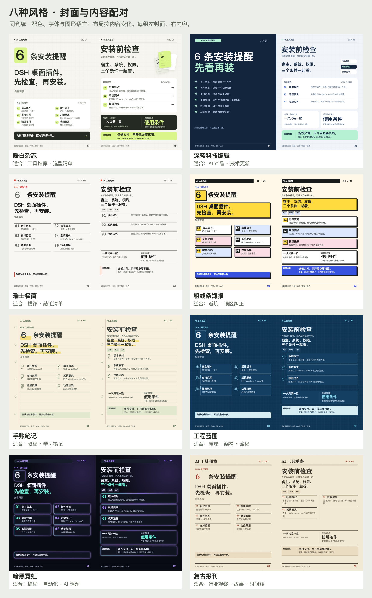

# Agent Skills 合集

收录可独立安装的 Agent 技能。每个技能放在 `skills/<技能名>/` 下，包含自己的 `SKILL.md` 与配套资源；按需安装单个技能，不必把整个仓库放进 Agent 的技能目录。

## 技能目录

| 技能 | 用途 | 当前适配情况 |
|---|---|---|
| [小红书信息图](skills/xiaohongshu-infographic/SKILL.md) | 制作 1080 × 1440 小红书信息图、轮播图和图解笔记，支持八种风格 | 已在 Qoder/macOS 与 DSH（Node 无浏览器导出）验证；其他 Agent 尚未端到端实测 |
| [竖屏科普视频](skills/create-explainer-video/SKILL.md) | 自然口播、统一音色、动态图解、同步字幕、独立封面及头像关注片尾 | Remotion 模板与媒体脚本在 macOS 验证；MLX 本地识别需 Apple Silicon，其他宿主需适配 |

## 竖屏科普视频

按“审稿 → 单页视觉样稿 → 音色试听 → 跨分镜连续样片 → 获准整片 → 封面/片尾审稿 → 合片验收”分阶段制作，认可样片不自动触发整片。新主题先确认风格和声音，不固定沿用参考配色或音色。

- 附 [Skill 科普最终版参考视频](skills/create-explainer-video/assets/reference/Skill是什么-最终版.mp4)（1080×1920、30 fps、约3分31秒）与 [独立封面](skills/create-explainer-video/assets/reference/Skill是什么-封面.png)，以及第二个完整案例 [MCP 科普关注片尾版](skills/create-explainer-video/assets/reference/MCP是什么-关注片尾版.mp4)（约3分21秒、浅色工程图解风）与 [其封面](skills/create-explainer-video/assets/reference/MCP是什么-封面.png)。参考片含用户头像，公开上传前另行确认授权。
- 包含可编辑 Remotion 模板、本地字幕对齐、渲染、全片解码验证与无声片尾无重编码拼接脚本；不包含密钥、个人凭证路径、参考配音原件或模型文件。
- 需要 Node.js、系统 Chrome/Chromium、FFmpeg/FFprobe；本地识别还需 Python、NumPy、MLX Whisper 与已有模型。安装、下载、收费配音和真人参考声音上传分别授权。
- 复制整个 `skills/create-explainer-video/` 到 `~/.qoder/skills/create-explainer-video/` 或项目技能目录；目标已存在时先比较或备份，不覆盖自己的修改。重载技能或新开会话后调用 `/create-explainer-video`。

```text
/create-explainer-video
把这份资料做成竖屏科普视频，先给口播稿和一张视觉样稿，再让我选音色。
```

详细流程见 [技能说明](skills/create-explainer-video/SKILL.md)；模板只在独立工作副本使用。两个参考视频合计约36 MB，安装时一并复制用于观察效果，不会自动发布或调用配音接口。

## 小红书信息图

先选择风格，再组织内容。支持工具横评、插件推荐、避坑、教程、原理解释及行业观察，同套封面、内容页和总结页统一配色、字体层级与图形语言。

### 风格预览

以下为版式示例，不作为示例产品、命令或版本兼容性的最新说明。



| 风格 | 适合内容 | ID |
|---|---|---|
| 暖白杂志 | 工具推荐、选型清单 | `magazine` |
| 深蓝科技编辑 | AI 产品、技术更新 | `tech` |
| 瑞士极简 | 横评、结论清单；灰色编号，少量红色点睛 | `swiss` |
| 粗线条海报 | 避坑、误区纠正 | `brutal` |
| 手账笔记 | 教程、学习笔记 | `notebook` |
| 工程蓝图 | 原理、架构、流程 | `blueprint` |
| 暗黑霓虹 | 编程、自动化、AI 话题 | `neon` |
| 复古报刊 | 行业观察、故事、时间线 | `newspaper` |

### 安装到 Qoder

1. 下载本仓库，或在本机终端执行：

   ```bash
   git clone https://github.com/cjy1998/skills.git
   ```

   此命令把仓库下载到当前目录下的 `skills/`，不会自动安装或启用技能；当前目录已有同名文件夹时，换一个目录执行。

2. 从克隆后的仓库根目录中找到 `skills/xiaohongshu-infographic/`，复制整个文件夹到以下位置之一：
   - 用户级：`~/.qoder/skills/xiaohongshu-infographic/`，供该用户的项目使用。
   - 项目级：`<项目根目录>/.qoder/skills/xiaohongshu-infographic/`，供该项目使用。
3. 若目标目录已存在，先备份或比较差异，不直接覆盖自己的修改。不要只复制 `SKILL.md`，模板、图片和脚本也需要保留。
4. 重载技能或新开会话，确认技能列表出现 `xiaohongshu-infographic`，再通过 `/xiaohongshu-infographic` 调用。

用户级路径以 macOS/Linux 的主目录写法表示；其他系统请以工具实际的技能目录为准。

### 使用示例

```text
/xiaohongshu-infographic
把这份资料制作成小红书图解笔记，先让我选风格。
```

```text
使用瑞士极简风，把这份工具对比资料做成 5 页信息图。
先给一张内容页样稿，不要编造价格或兼容版本。
```

### 运行条件与产物

- 需要文件读写与命令执行能力、Python 3、本地浏览器或浏览器自动化工具；Node.js 用于脚本语法检查。
- 绘图使用浏览器 Canvas 2D，不依赖图片生成 API。Python 服务和打包脚本只使用标准库。
- 当前模板在 macOS 字体环境验证，使用 PingFang SC、Hiragino Sans GB、Menlo；复古报刊标题使用 Songti SC/STSong。其他系统的字体替换可能改变换行和宽度，必须重新检查排版。
- 每次使用独立工作目录，模板中 `STYLE_ID` 初始为 `null`，必须先选择风格，再填写 `CONTENT`，不要直接改技能资源来保存某篇笔记。
- 导出逐页 PNG、总览图、笔记文案及发布素材 ZIP。文字溢出诊断必须为空，导出后还要逐图检查。
- 图片目检需要具备图像输入能力的模型；模型无法识图时，应由人工检查，不把代码校验等同于视觉验收。
- 不自动发布到小红书；价格、活动条件、版本与资料来源需要针对每次任务重新核实。

详细操作见 [技能说明](skills/xiaohongshu-infographic/SKILL.md) 与 [风格规范](skills/xiaohongshu-infographic/references/style-guide.md)。

### DSH 与其他 Agent

技能的模板、参考文档及 Python 脚本可以迁移，但当前操作说明仍包含 Qoder 的工具名称和运行约定，不能保证复制后在其他 Agent 中直接完成全流程。

- DSH 支持文件夹式 `SKILL.md` 技能；文件能够被发现，不代表运行依赖和工具调用已经兼容。
- 自动导出需要能打开本地预览并执行 JavaScript 的浏览器工具。DSH 桌面的实验性浏览器 MCP 需按其文档启用，不能把普通 Web 界面等同于浏览器自动化。
- 风格选择交互、运行时路径、后台服务管理、浏览器工具名和参数、图片读取方式需按宿主适配，不照抄 Qoder 本机可执行文件路径。
- DSH（Web 端，Node 无浏览器导出）已完成端到端实测：v24 下八种风格各出 3 页、质检打包通过。其他 Agent 尚未实测，也没有声明最低兼容版本。

参考：[DSH 技能机制](https://github.com/deepseek-ai/deepseek-harness/blob/master/packages/skill/skill-filesystem/README.md) · [DSH 浏览器能力](https://github.com/deepseek-ai/deepseek-harness/blob/master/docs/subsystems/browser-use.md)。

## 仓库结构

```text
skills/
├── README.md
├── .gitignore
└── skills/
    ├── xiaohongshu-infographic/
    │   ├── SKILL.md
    │   ├── assets/
    │   ├── references/
    │   ├── node/
    │   └── scripts/
    └── create-explainer-video/
        ├── SKILL.md
        ├── assets/
        ├── references/
        └── scripts/
```

后续技能各自新增 `skills/<技能名>/SKILL.md`，配套脚本与资源保留在该技能目录内，并更新首页目录。不要提交 API 密钥、个人账号配置、聊天记录或私人素材。

本地预览服务仅绑定 `127.0.0.1`；只服务独立素材目录，不把个人主目录作为服务根目录，也不要开放到公网。文件写入、运行命令和浏览器操作仍需遵守所在 Agent 的权限确认。

## 许可证

本仓库尚未指定开源许可证。公开可见不等于自动获得任意使用、修改或再分发授权；授权范围以仓库所有者后续明确的许可为准。
